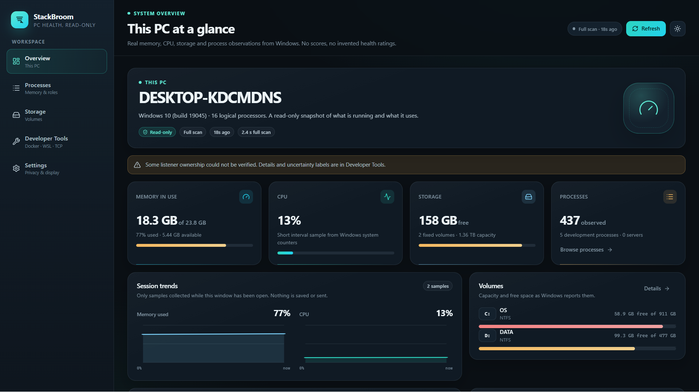
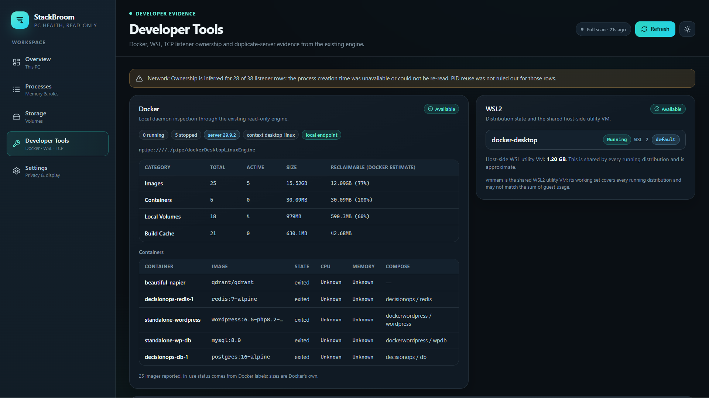
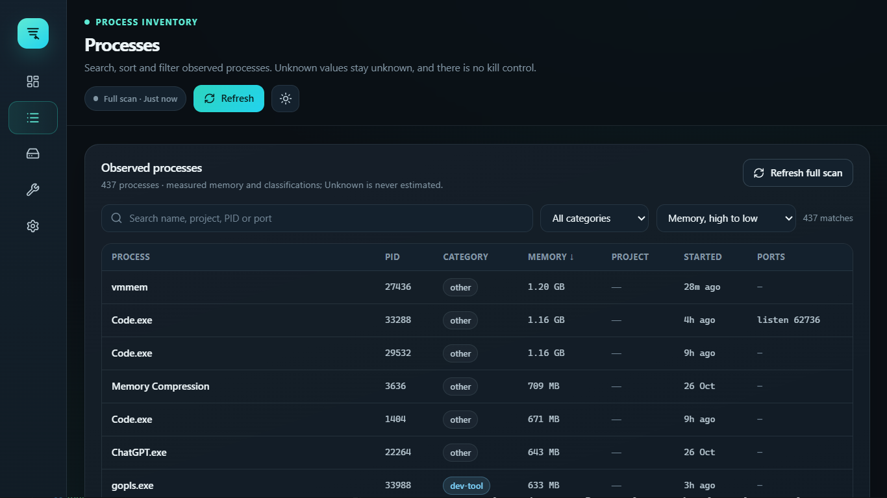
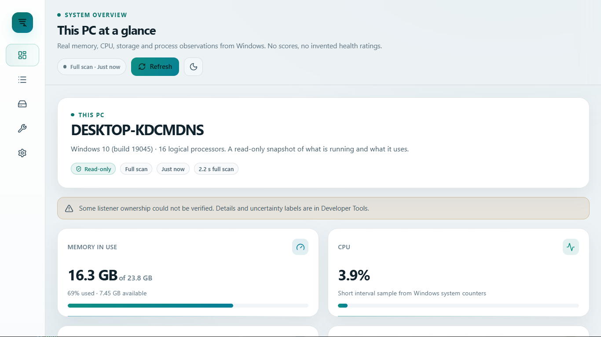

# StackBroom Desktop — Visual and UX Review

## Result

A working, read-only Windows desktop MVP built on Wails v3.0.0. All five navigation destinations have a real purpose and show measured data. There is no cleanup control, no AI call and no background network listener.

## Screens

### Overview

- Computer name, Windows build, logical processor count.
- Physical memory total/available/used with a clear percentage.
- CPU from a 300 ms Windows system-counter sample, labelled as such.
- Fixed-volume capacity/free space and per-volume usage.
- Observed process count, development-process count and dev-server count.
- Top memory consumers (working set, with the caveat that shared pages can be counted more than once).
- Session-only memory/CPU lines; no invented history.
- Evidence-led review cards, labelled "Review only".
- Last quick/full scan, duration and partial-source warnings.

### Processes

- All observed processes with PID, category, memory, project association, start time and requested/observed ports.
- Search by name, project, PID or port.
- Category filter and sortable columns.
- Unknown memory/start time stay "Unknown".
- 50-row pagination and deferred search keep large inventories manageable.
- No kill or action button.

### Storage

- Fixed-volume capacity, free, used and percentage.
- Per-volume progress with amber/red thresholds.
- Explicit statement that used space is not a reclaimable estimate.
- No folder traversal, duplicate detection or deletion.

### Developer Tools

- Docker availability, server version, context, local endpoint, running/stopped counts.
- Docker storage categories with Docker's own reclaimable estimate.
- Containers, images count and warnings.
- WSL distributions and shared host-side `vmmem`/`vmmemWSL` memory as approximate.
- TCP listeners with address, family, PID, process, project and confirmed/inferred/uncertain ownership.
- Requested versus observed port evidence.
- Duplicate-server evidence as a review prompt, never a verdict.
- Full recommendation cards with evidence, review steps, risk and confidence.
- Remote Docker endpoints remain refused; there is no override in the desktop shell.

### Settings

- Dark/light theme.
- Automatic quick-refresh interval (off by default); Docker/WSL are never polled on a timer.
- Developer Tools visibility.
- Privacy boundaries, no-listening-port statement, no-AI statement.
- Version, engine schema, toolchain and known limitations.
- Go 1.27.3 security-update note without changing system tooling.

## Visual system

- Dark-first charcoal/navy surfaces with restrained teal/cyan accents.
- Amber for caution; red only for meaningful pressure such as a volume at 94%.
- Segoe UI Variable typography; Cascadia Mono for figures and addresses.
- Subtle gradients, borders and elevation; no heavy glass effects.
- Reusable cards, badges, progress bars, tables, review cards, segmented controls and switches.
- Session charts are genuine SVG plots of samples collected during this window.

## Responsive findings

Screenshots were captured at exact client sizes:

- **1366×768** at 125% Windows scaling → 1093 CSS px: icon-rail sidebar, two-column KPI grid, stacked two-column sections. This is intentional and readable without horizontal clipping.
- **1920×1080** at 125% scaling → 1536 CSS px: full sidebar labels, four KPI columns, side-by-side detail cards.
- A 1366×768 window at 100% scaling shows the full-labeled sidebar and four KPI columns.

Defects found and corrected during the visual audit:

1. The original Wails minimum width (1180 DIP) prevented a 1366×768 physical target at 125% scaling. Lowered to 900×560 and verified at both sizes.
2. The initial screenshot tool was DPI-unaware and captured the wrong window region. Replaced with a DPI-aware client-rectangle capture.
3. The Docker storage table could overflow its grid card and cover the WSL panel. Added card clipping and stacked two-column layouts below 1200 CSS px.
4. SVG chart labels stretched under `preserveAspectRatio="none"`. Moved axis labels to HTML.
5. Focus remained on the previously active navigation item. Moved focus to the page heading after navigation, with a visible main-content focus target.
6. Content scroll position persisted between screens. Reset to the top on navigation.
7. Preview/screenshot runs could inherit auto-refresh or a theme. Added a read-only preview flag that forces a fixed theme and no timer.

Remaining responsive risks:

- Long project/container names are ellipsized with title attributes; extremely long names are not wrapped.
- The process table scrolls horizontally on narrow layouts rather than collapsing columns.
- 1920×1080 screenshots use the preview frameless window because this display cannot host a 1080-client bordered window; production keeps the native frame.

## Accessibility findings

Implemented:

- Semantic `h1`/`h2`, navigation landmark and main landmark.
- `aria-current="page"` on the active destination.
- Skip-to-main-content link.
- Visible `:focus-visible` outlines on interactive controls.
- Keyboard shortcuts: Ctrl+1–5 navigate, Ctrl+R refreshes, Ctrl+Shift+D/L force dark/light.
- `aria-label`/`aria-live` on scan status; progress bars expose min/max/now.
- Table captions and labelled search/filter controls.
- Buttons and switches have accessible names; switches use `role="switch"` and `aria-checked`.
- Reduced-motion media query disables animations and transitions.
- Light theme with darker accent text for contrast.
- Unknown values are text, not blank cells or zero.

Not yet verified:

- Narrator/Windows screen-reader pass.
- Automated axe/Lighthouse audit inside WebView2.
- Full keyboard-only traversal of every table and all scroll regions.
- 200% Windows text scaling.

These remain explicit validation gaps rather than claims of compliance.

## Screenshot index

All 20 images are in [`screenshots/`](screenshots/), captured from the real executable:

- `overview-{dark,light}-{1366x768,1920x1080}.png`
- `processes-{dark,light}-{1366x768,1920x1080}.png`
- `storage-{dark,light}-{1366x768,1920x1080}.png`
- `developer-{dark,light}-{1366x768,1920x1080}.png`
- `settings-{dark,light}-{1366x768,1920x1080}.png`

